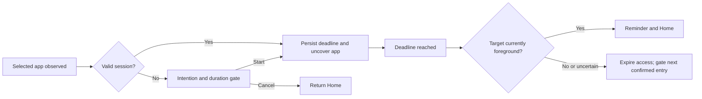

# Accountability Check: MVP plan and implementation handoff

Prepared: 25 September 2026. This is the original planning snapshot. The user authorized implementation on 25 September 2026; see [implementation status](IMPLEMENTATION-STATUS.md) for what has actually been built and tested. The user later requested a persistent time-up reminder, superseding this snapshot's three-second auto-dismiss proposal. Read [the research](ANDROID-RESEARCH.md) for the evidence and API limitations behind this plan.

## Objective and boundary

Help someone use their phone deliberately: require an intention and duration, remind them of that intention at the deadline, return them Home, and require a fresh decision before continuing.

This is voluntary accountability. It cannot prevent its owner disabling the service, guarantee zero frames of target-app exposure, force-stop another app, or verify completion of an in-app task. The first validated support claim should be ordinary, single-window phone use on tested devices.

Implementation is authorized. The original plan was saved before any Android project or device experiments were started.

## Proposed product defaults

These are recommendations that can be adjusted before implementation.

| Decision | Proposed default |
| --- | --- |
| Distribution | Test on the user's phone first, keeping a future Play release viable. Awaiting user preference. |
| Initial mode | Selected-app sessions. Add the unlock mode as a separate opt-in milestone. |
| Apps | User explicitly selects launchable apps. Essential system flows cannot be selected. |
| Purpose | Required trimmed text, 1–200 characters; do not try to infer whether it is a worthy purpose. |
| Duration | Whole minutes, 1–120; presets 2, 5, 10, 15 plus custom entry. |
| Budget | Elapsed time from Start, continuing while away or screen-off. Explain this in the form. |
| Returning early | Reuse the same unexpired app session; never silently reset its deadline. |
| Multiple apps | One session per package, with independent deadlines. Only one gate is visible. |
| Expiry | Block target interaction with reminder, request Home, require a fresh intention on return. |
| Continuing | A deliberate new session with a new form. No automatic extension or one-tap snooze. |
| Recovery | Preserve same-boot deadlines; invalidate sessions on reboot or uncertain timing state. |
| Data | On-device only; no account, backend, analytics SDK, advertising, or AI dependency. |

No response to the device/distribution questions is assumed to authorize building.

## Main user journey

1. Explain the feature and its limits; show separate accessibility disclosure and consent.
2. User enables the service in Android Settings and selects apps to protect.
3. User opens Instagram through its icon, Recents, a link, or a notification.
4. Once detected, an opaque overlay says “What are you here to do?” and asks for a duration. The user can Start or Go Home.
5. User enters “Upload to my story” and five minutes. Persist that session, then uncover the original Instagram screen.
6. At expiry, cover Instagram with “You planned to: Upload to my story. Your 5 minutes are up.” Request Home immediately. A brief reminder may remain over the launcher before dismissing; a notification is supplementary if permission was granted.
7. Opening Instagram again requires a fresh intention and duration. Navigating inside Instagram during an active session does not repeat the form.

If the user is elsewhere at expiry, mark that app's session expired and optionally notify; do not send the unrelated app Home. Returning to the expired app shows the gate. Cancellation never grants access. Back may first close the keyboard; leaving the form without Start routes Home when it is safe to do so.

## Unlock mode: explicit, separate milestone

Keep app mode and phone-unlock mode mutually exclusive in the first implementation to avoid overlapping timers and duplicate prompts. Proposed unlock-mode behavior:

Changing modes ends existing active sessions as interrupted, removes pending gates, and starts the new mode without inheriting access from the old one.

- After Android finishes unlocking, ask “What are you using your phone for?” with the same duration form. On a no-lock device, trigger after wake instead.
- Create one phone-purpose session whose elapsed budget continues while switching apps. Do not display separate per-app forms during it.
- At expiry, remind and return Home only from a confidently identified eligible app. If already Home, display the reminder without a navigation action. If in a call, Settings, keyguard, or another excluded/uncertain context, defer intervention.
- After expiry, entering a selected protected app requires a new phone-purpose session. Essential and unselected apps remain usable; this does not lock the entire phone.
- Each new lock/wake cycle asks again; close the previous phone session as interrupted if it was still active. Debounce duplicate system signals into one prompt. This reset is a deliberate mode behavior, not a claim of tamper resistance.
- A single coordinator handles wake and app-entry signals so unlocking into Instagram yields one form. Screen-off removes the form before system authentication appears.

This mode is opt-in and experimental until the unlock acceptance tests pass on the user's device. The selected-app milestone can be evaluated earlier, but must not be described as completing unlock support. If the user wants both modes simultaneously or an actual whole-phone lockout, revise these rules first.

## Native architecture

Recommendation at planning time: Kotlin, Android SDK, Jetpack Compose/Material for ordinary screens, coroutines/Flow, DataStore for settings, and Room for durable sessions and a small local history. The implementation uses one atomic DataStore record for both settings and bounded sessions; this avoids coordination between two stores for this small offline MVP. Start with one app module and explicit boundaries, not a multi-module framework. Pin compatible stable dependencies at implementation time.

Provisional `minSdk=29` (Android 10). Target API 36 or higher to meet the researched Play requirement; choose compile/target versions with the current stable toolchain and test relevant behavior changes. The test phone can change the minimum-support decision.

| Component | Responsibility |
| --- | --- |
| MainActivity | Onboarding, disclosure, app picker, mode/settings, current sessions, basic history, service status |
| AccountabilityAccessibilityService | Receive relevant events, register wake receivers, own service lifecycle and overlay attachment |
| ForegroundClassifier | Convert package/window signals into known target, excluded surface, or uncertain state |
| GateCoordinator | Serialize all gate requests; keep one overlay; deduplicate wake/app signals and own events |
| SessionEngine | Pure session rules, deadlines, transitions, expiry and re-entry decisions |
| SessionRepository | Transactional active-session persistence and bounded local history |
| DeadlineScheduler | Schedule nearest deadline while connected; always recheck elapsed time on callback |
| OverlayController | Focusable blocking form, keyboard, reminder, cleanup, and safe Home navigation |
| Health/status screen | State clearly when protection is enabled, disconnected, or needs user action |

The first overlay proof may use Android Views to reduce lifecycle/keyboard complexity. Compose can be embedded after its owners, focus, and insets are proven; the UI framework does not determine whether interception works.

The form must be touchable and focusable; do not set `FLAG_NOT_FOCUSABLE` or `FLAG_ALT_FOCUSABLE_IM` on the text-entry window. Verify IME behavior rather than assuming ordinary Activity keyboard behavior carries over.

### Foreground observation and safe navigation

- Start with `TYPE_WINDOW_STATE_CHANGED`, package/type/time only, and `canRetrieveWindowContent=false`. Never read event text, roots, node contents, or screenshots.
- Do not add `TYPE_WINDOWS_CHANGED` expecting it to work without the extra retrieval capability. See the research constraint.
- Observe enough package transitions to know when the user leaves a selected app; filtering the service exclusively to selected packages loses that information. Keep non-selected package observations transient and do not build a general usage log.
- Track IME/system/own-overlay events separately from ordinary app transitions. An IME event is not automatically a new app or permission to retain stale ownership forever.
- Serialize classifier changes, session transitions, and navigation. Check interactive state, keyguard, session identity, and current target ownership immediately before expiry intervention.
- On uncertain ownership, do not issue Home or cover a possibly unrelated surface. Re-evaluate on the next reliable event. This conservative behavior is part of the first support contract.
- Exclude our app, launcher, Settings, permission controller, installers/uninstallers, active keyboard, dialer/emergency/call UI, keyguard, and critical System UI. Resolve relevant packages/roles instead of assuming Pixel package names everywhere.
- Remove/suspend overlays when excluded or uncertain contexts take over. At expiry, request Home and clean up after the transition; handle action failure and use a bounded dismissal fallback so a reminder cannot trap the phone.
- The launcher is never a protected target. Two deliberate exceptions allow UI over it: the opted-in phone-purpose form after unlock, and a brief expiry reminder. The reminder auto-dismisses within three seconds and has an immediate dismiss action; the phone-purpose form provides a cancel/pause escape. Neither covers calls, Settings, or authentication.
- Inspect the return value of `performGlobalAction()`. No claim of successful navigation is based only on requesting it.

### Persistence and timer contract

Store session ID, scope (package or phone), package if applicable, intention, chosen duration, start/deadline elapsed times, wall timestamps for display, boot marker, status, and end reason. Keep one active record per scope and one outstanding overlay request with a generation/session ID.

Persist acceptance before uncovering the app. At restore, use the same-boot monotonic deadline. Check a reliable boot marker such as the public boot count where available; if boot identity cannot be established, invalidate existing sessions. Wall-clock timestamps are for display, not extending access.

States: `PROMPT_REQUIRED → ACTIVE → EXPIRED`; session history may also end as `CANCELLED`, `INTERRUPTED`, or `REBOOT_INVALIDATED`. Overlay visibility is separate from session state. Duplicate events and stale callbacks cannot start a second session, add time, or close a newly started session.

No perpetual one-second polling loop is needed. Schedule the next deadline and refresh UI only while visible. During sleep, no exact alarm or wake lock is required for the initial contract: reconcile immediately on the next usable event. Service reconnection restores state; permission revocation removes overlays and reports protection unavailable.

### Permissions, consent, and local data

Declare the service with `BIND_ACCESSIBILITY_SERVICE` protection and appropriate metadata; this is system binding, not a normal permission popup. The user explicitly enables it in Accessibility settings after in-app consent. Use `isAccessibilityTool=false`/unset.

Request notification permission only for optional notifications. Use scoped package visibility for the picker. Do not initially add Usage Access, `QUERY_ALL_PACKAGES`, `SYSTEM_ALERT_WINDOW`, Device Admin, exact alarms, or a generic foreground service.

Draft disclosure, to finalize against actual implementation: “Accountability Check uses Android Accessibility to observe which app window is active, show your intention prompt, and return you Home when your chosen time expires. It uses app identifiers and window events. Your intentions and sessions stay on this device. You can disable it in Android Settings.” Explain the actual data use accurately; do not imply Android grants only our narrow chosen capabilities.

Do not log intentions or event payloads. Keep history bounded (proposed 30 days), offer Delete History, and prevent intention/session data entering automatic cloud backup if claiming local-only storage. Revise disclosure if capabilities change.

## Implementation sequence, after authorization

### Milestone 1 — Prove the risky mechanisms

Inspect local instructions and toolchain first. Scaffold a minimal native project only after the user's go-ahead. Use one selected test app and a short development-only timer.

Prove event classification, a text-entry overlay with a working keyboard, preservation of the original target screen, expiry/Home behavior, re-entry gating, Settings escape, and same-boot restart recovery. Log timings and package transitions without content. Also probe unlock signals and overlay ordering; do not yet promise support.

Exit: a device demonstration and a short findings note, including failed cases. If event-only foreground classification or overlay input fails materially, revisit the design before building polished screens. A broader capability request must be justified by evidence and reflected in disclosure.

### Milestone 2 — Selected-app MVP

Add consent/onboarding, scoped app picker, complete form validation, session persistence, independent per-app budgets, expiry reminder, fresh-session re-entry, basic history, pause and health UI. No backend is needed.

Exit: the Instagram example works through icon, Recents, link, and notification entry on the test phone; deadlines cannot reset through incidental navigation or app/process recreation.

### Milestone 3 — Unlock mode

Implement the proposed separate phone-purpose mode, runtime receivers, keyguard/interactive checks, wake-cycle deduplication, and deferred handling for critical surfaces.

Exit: real-device unlock matrix passes; mode availability and limitations are accurately described. If the device cannot support it reliably, report the concrete failure rather than silently dropping the feature or advertising it.

### Milestone 4 — Reliability and distribution readiness

Test another manufacturer, current target behavior, supported older OS versions, permission denial/revocation, battery restrictions, reboot, and accessibility coexistence. Prepare the privacy policy, store wording, data-safety answers, Accessibility declaration, and video if Play distribution is chosen. Submission/review is distinct from technical completion.

Exit: installable tested build, installation instructions, known limitations, measured supported-device results, and truthful permission/protection status. Publishing requires a separate user instruction.

## Acceptance and testing

Automated tests should target the pure session engine and persistence races: duplicate events, switching packages, expiry while away, wall-clock changes, same-boot restoration, reboot invalidation, stale callbacks, and competing wake/app gates. Use device tests/manual checks for behaviors an emulator cannot establish reliably.

| Scenario | Required result |
| --- | --- |
| Open selected app without a session | One form appears; target touches are blocked after attachment. Measure launch-to-gate delay. |
| Submit or cancel | Valid submission reveals original screen; cancellation grants no session and safely exits. |
| Navigate inside app / open keyboard | No duplicate form, no reset, typing works. |
| Leave and return before expiry | Original intention/deadline continues. |
| Deadline while actively using target | Reminder and Home; next entry requires a fresh form. |
| Static target screen without recent accessibility events | Deadline still fires; a simplistic event-age heuristic does not disable the cutoff. |
| Deadline while in another app/call/Settings | Other activity is not dismissed or covered. |
| Rapid switch at expiry / unknown foreground | No stale Home action; expired target gates when next confidently observed. |
| Sleep past deadline | No lockscreen interference; expire on wake/re-entry without adding time. |
| Process recreation or service reconnect | No fresh budget from restoring an existing session. |
| Reboot / clock change | Reboot invalidates sessions; wall-clock edits cannot extend same-boot timers. |
| Permission disabled or app force-stopped | No false claim that enforcement remains active. |
| PIN, fingerprint, face, swipe, trusted state, no lock | Unlock mode prompts once at the correct post-auth/wake point. |
| Calls, emergency UI, uninstall/permission screens | Remain accessible; overlay never traps user. |
| Notification/deep-link entry | Target destination survives accepting the prompt. |
| Split-screen, PiP, work profile, clone/private space | Evaluate and record; do not claim support until proven. |

Suggested engineering targets, **not measured results or Android guarantees**: on the supported single-window test device, at least 95% of 30 repeated entries gated within 500 ms; connected screen-on cutoff within 1 second; zero duplicate prompts or unrelated-screen Home actions across the tested matrix. A missed target or trapped critical screen blocks the reliability sign-off. Record battery behavior over representative use, rather than promise a percentage in advance.

## Intentionally outside the first version

AI judging task completion; screen-content inspection; root or managed-device enforcement; guaranteed all-device coverage; subscriptions; social accountability; remote reporting; cloud sync; website blocking; cross-platform support; preventing uninstall; and reliable termination of background media/uploads.

## Resume checklist

1. The user gave the go-ahead to start implementation on 25 September 2026.
2. Confirm test phone/Android version and distribution preference; these questions have been asked but no answers were available when this plan was saved.
3. Read this plan and the research, then inspect any new workspace instructions or files.
4. Recheck relevant platform/policy and compatible stable build-tool versions.
5. Start milestone 1, report evidence, and progress through the authorized MVP scope. Do not treat writing these documents as having tested any Android behavior.
